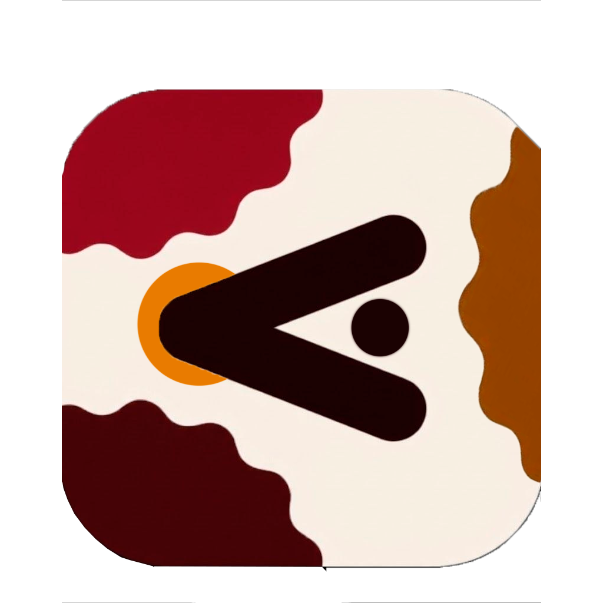
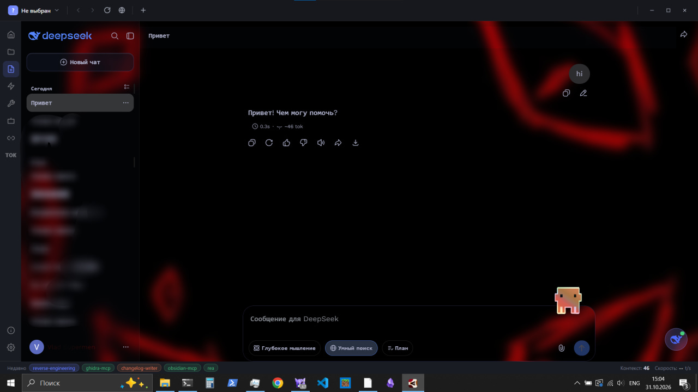
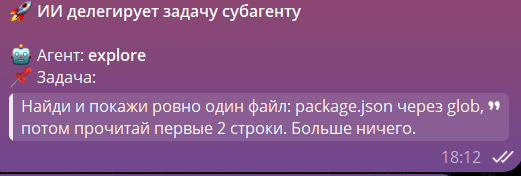
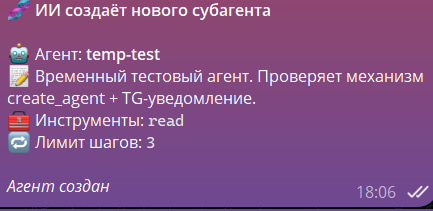

# Cookie Code 🍪

<p align="center">
  
</p>

<p align="center">
  <a href="https://github.com/merfiDEV/Cookie-code/releases/latest"></a>
  <a href="https://github.com/merfiDEV/Cookie-code/blob/master/LICENSE"></a>
  <a href="https://github.com/merfiDEV/Cookie-code"></a>
  <a href="https://github.com/merfiDEV/Cookie-code"></a>
</p>

<p align="center">
  <strong>English</strong> · <a href="README.ru.md">Русский</a>
</p>

<p align="center">
  
</p>

**Cookie Code** turns the DeepSeek web chat into a developer workstation. The AI opens files in your project, runs commands, edits code, and commits, and you stay in the same chat.

The app works through your regular DeepSeek web account. No API key, and you do not pay per token.

---

## Why this exists

The DeepSeek web chat thinks well, but it cannot see your project. It cannot open a file, run a test, or make a commit, so you end up copying code back and forth.

Cookie Code adds a local executor to the chat. The AI writes a block that calls a tool, the app intercepts the block, runs it in a Node sandbox, and streams the result back into the chat. The loop then repeats: think, act, read the result.

What you get:

- A workflow on your regular DeepSeek web account, with no API keys and no per-token billing.
- A full agent loop: file reads, edits, shell commands, SQL queries, MCP tools.
- Subagents in separate windows with their own context and their own tool allowlist.
- Git inside the app: diff, history, commit, push.
- Control from your phone through Telegram.
- A UI you can rebuild: wallpapers, glass effects, fonts, themes.

---

## Features

### An AI agent that works on your code

The AI can:

- Read files: project structure, file contents, pattern search.
- Write and edit code: create files, apply patches, delete stale code.
- Run commands: bash, PowerShell, SQL queries, any shell script.
- Search the project: files by glob, contents by regular expression.
- Keep a task list: create, update, delete.
- Fetch data over HTTP and call APIs.
- Connect MCP servers and call their tools.
- Remember you and the project in two memory levels.
- Follow project rules from `.cookie/rules.md`.

What the loop looks like:

1. You type: "Show recent changes in auth.js".
2. The AI replies with a ```cuckoo block that calls grep.
3. Cookie Code runs the call and streams the result into the chat.
4. The AI reads the output and continues.

### Two-level memory

The AI remembers both you and the project:

- Global memory (`<userData>/memory.md`) holds facts about you and your system.
- Project memory (`<projectDir>/.cookie/memory/ProjectMemory.md`) holds conventions, architectural decisions, and key paths for that project.

The `memorySave`, `memoryRead`, and `memoryClear` tools take a `scope` argument with the values `project`, `global`, or `all`. Both files can be opened and cleared from Settings.

### Project rules

A `.cookie/rules.md` file sets rules the AI must accept through `readrules()`. Until the rules are accepted, tools that change files stay locked. No file means no lock. Subagents bypass this gate.

### Subagents

<p align="center">
  
  
</p>

The AI delegates tasks to isolated agents. Each one runs in its own window with its own context, and only the final summary returns to the main conversation. Drafts and intermediate tool calls never pollute the parent chat.

How it works:

1. You ask: "Delegate to explore: find every call to apiFetch".
2. The AI calls `run_agent("explore", "...", "...")`.
3. A separate window opens with the same DeepSeek login.
4. The subagent works in isolation: `glob → read → grep`.
5. When it finishes, the window closes and the summary appears in the chat.

Three ways to create an agent:

- Manually: drop `cookie/agents/<name>.md` with frontmatter into the project.
- Through the AI: say "Create an agent for SQL migration review", and the AI calls `create_agent` and uses it right away.
- Use a built-in one: `explore`, `code-reviewer`, `git-committer`, `changelog-writer`, and `page-scripter` already ship in the project.

What constrains a subagent:

- Tool allowlist. Set `tools: read, grep`, and the agent physically cannot call `bash` or `mysql`.
- No recursion. A subagent cannot spawn another subagent.
- A step limit (`maxTurns`) that breaks infinite loops.
- A 10-minute timeout that closes a hung window.

Agent example:

```markdown
---
name: code-reviewer
description: Review code quality. Use after writing code.
tools: read, grep, glob
maxTurns: 20
---

You are an experienced code review expert...
```

### Goals

The `/goal` command turns a task into a self-driving loop: the AI advances step by step without input from you between steps.

- `/goal <description>` sets a goal, `/goal` shows status, and `/goal stop|pause|resume` controls it.
- When a response round ends, Cookie Code sends "continue" to the AI automatically.
- The goal completes when the AI calls the `goalDone()` tool.
- Loop protection: a 50-iteration limit and a stop after three rounds without progress.
- The Goal panel on the left shows the goal text, the iteration number, a timer, and Pause and Exit buttons.
- Every chat has its own goal.
- You can set and manage goals from Telegram with `/goal`, and start and completion notifications arrive there.

### Interface

- Glass panels with configurable blur and opacity.
- 27 wallpapers included.
- Animated pets that react to your work.
- Dark and light themes, switched automatically or by hand.
- Your own typeface: drop a file in the folder and pick it in Settings.
- An RGB glow for the username.

### Safety

- Tool approval: risky commands run only after you confirm them.
- Dangerous patterns: regular expressions for commands that must never run.
- Hidden service messages: the chat stays clean while the AI still sees the full context.
- Session allowlist: approve a tool once and it runs freely until reload.
- Project rules: the AI accepts them through `readrules()` before starting work.
- Plan mode: the AI writes a plan to `plan.md` instead of changing code. You approve or reject the plan, and you can leave comments on its lines.

### Project prompts

Prompts live in `.cookie/prompts/*.md`, and the Prompts button opens them in the overlay. You can create, edit, delete, and insert a prompt into the input with one click. The `/prompts` command does the same from Telegram.

### Telegram bot

Control the app from your phone:

- `/status` shows the current project, active processes, and task count.
- `/diff` sends uncommitted changes with syntax highlighting.
- `/log` browses commit history and shows the diff of a selected commit.
- `/todos` manages the task list.
- `/prompts` opens project prompts.
- `/screen` takes a screenshot of the active window.
- `/stop` kills runaway processes.

Incoming messages are typed into the chat. Voice messages are transcribed by local Whisper and sent to the AI. Photos and files are attached to the input field.

### Git

A built-in diff viewer:

- The Changes tab shows uncommitted edits line by line.
- The History tab browses commits, and a click opens the full diff.
- Navigation jumps between hunks and filters added and removed lines.
- A minimap gives an overview of the whole change.
- Inline diff highlights character-level differences.
- The Commit button assembles the unified diff of every changed file and posts a message to the chat asking for a commit. You can then summon the `git-committer` agent or commit yourself.

### Hotkeys

| Key     | Action                                      |
| ------- | ------------------------------------------- |
| **F1**  | Show the current CHANGELOG (What's New box) |
| **F11** | Fullscreen mode                             |
| **F12** | Developer tools (DevTools)                  |

---

## What's new

Recent major changes:

- **A new VS Code style shell.** The UI was rewritten: an activity bar on the left, a page panel (Home, Workspaces, Files, Prompts, Skills, Subagents, MCP, Token, About), and a status bar. The window has no system frame and uses its own buttons, and F11 goes fullscreen.
- **Project file tree.** Folders and subfolders expand, up to 6 levels deep and 500 entries per folder. The **@** button inserts `User mentioned file: <absolute path>` into the chat, or `User mentioned folder: <absolute path>` for a folder. Name and path search, a Monaco preview, and open-in-system are included.
- **Subagents in separate lightweight windows.** The window opens straight into a DeepSeek chat with the prompt and its own context, with no extra panels.
- **Speed and tokens.** Output speed is computed from the difference in the server-side `accumulated_token_usage` and shown in real time. Context and speed appear in the status bar.
- **A "Task detected" block and History.** Home shows the current command or task, a progress indicator, a **Kill** button, and a collapsible history of executed commands instead of an empty placeholder.
- **Project prompts.** Stored in `.cookie/prompts/*.md`, created, edited, and deleted in the UI, and inserted into the input with one click.
- **Updates.** The "Check for updates" button reports an honest result: up to date, a new version available, the update downloaded, an error, or unavailable in dev mode. The version on the About page comes from the latest `CHANGELOG.md` entry.

### Statistics

- A GitHub style activity heatmap.
- Token usage by day and by week.
- Your most used models.
- Your longest coding streak.

---

## Quick start

### Download a build

**Windows:** download [CookieCode-Setup.exe](https://github.com/merfiDEV/Cookie-code/releases/latest), run the installer, open the app.

**macOS:** download [CookieCode.dmg](https://github.com/merfiDEV/Cookie-code/releases/latest), drag it to Applications, open it.

### Build from source

```bash
git clone https://github.com/merfiDEV/Cookie-code.git
cd Cookie-code
npm install
npm start
```

You need Node.js 16 or newer.

---

## Usage

### First launch

1. Pick a project directory.
2. Pick a theme: wallpaper, glass effects, pet.
3. Optionally set up the Telegram bot.

### Working

Just talk to the AI:

```
You: "Show the changes I made today"
AI: runs git diff and lists three changed files

You: "Write tests for the login function"
AI: reads auth.js, creates the tests, runs them, and reports the result

You: "Commit this"
AI: runs git commit with the message "feat(auth): add login tests"
```

The side panel opens sessions, the task list, the git diff, and settings.

---

## Built-in tools

The app registers 44 tools. The main ones:

| Tool                | Description                    |
| ------------------- | ------------------------------ |
| `read`              | Read file contents             |
| `write`             | Create or overwrite a file     |
| `edit`              | Apply a targeted patch         |
| `glob`              | Find files by pattern          |
| `grep`              | Search file contents           |
| `bash` / `pwsh`     | Run shell commands             |
| `mysql`             | SQL queries                    |
| `webFetch`          | HTTP requests                  |
| `todoWrite`         | Task lists                     |
| `mcpCall`           | Call an MCP server tool        |
| `skillLoad`         | Load a custom skill            |
| `run_agent`         | Delegate a task to a subagent  |
| `memorySave`        | Write a fact to memory         |
| `goalDone`          | Complete a `/goal`             |
| `readrules`         | Accept project rules           |
| `ask_user_question` | Ask a clarifying question      |
| `exitPlanMode`      | Submit the plan from `plan.md` |
| `attachFile`        | Attach a file to the chat      |
| `cityTime`          | Current time and city          |

Full TypeScript declarations live in [`tools/cuckoo-tools.d.ts`](tools/cuckoo-tools.d.ts).

---

## Customization

**Themes:** background blur, panel opacity, glass color.

**Pets:** drop PNG or GIF files into `userData/pets/` and pick one from the grid.

**Fonts:** drop `.ttf` or `.woff` files into `userData/fonts/` and pick one from the list.

**Skills:** a folder with `SKILL.md` and an optional `tool.js` in `.cuckoo/skills/<name>/` for one project, or in `<userData>/skills/<name>/` for every project. A global skill overrides a project skill with the same name.

---

## Contributing

1. Fork the repo.
2. Create a branch: `git checkout -b feature/amazing`.
3. Make your changes.
4. Run the tests: `npm test`.
5. Commit: `git commit -m 'feat: add feature'`.
6. Push the branch and open a pull request.

Where help is welcome:

- Translations.
- Documentation.
- Bug reports.
- New tools.

---

## License

MIT. Use, modify, and redistribute freely, including in commercial projects.

---

## Credits

Built with [Electron](https://electronjs.org/), [DeepSeek](https://deepseek.com/), and [Telegraf](https://github.com/telegraf/telegraf).

Inspired by [Aider](https://github.com/paul-gauthier/aider), [Claude Desktop](https://claude.ai/download), and [Cursor](https://cursor.sh/).

---

## Star history

[](https://star-history.com/#merfiDEV/Cookie-code&Date)

If Cookie Code saves you time, give it a star.

---

<p align="center">
  Made with 🍪 by developers, for developers
</p>
