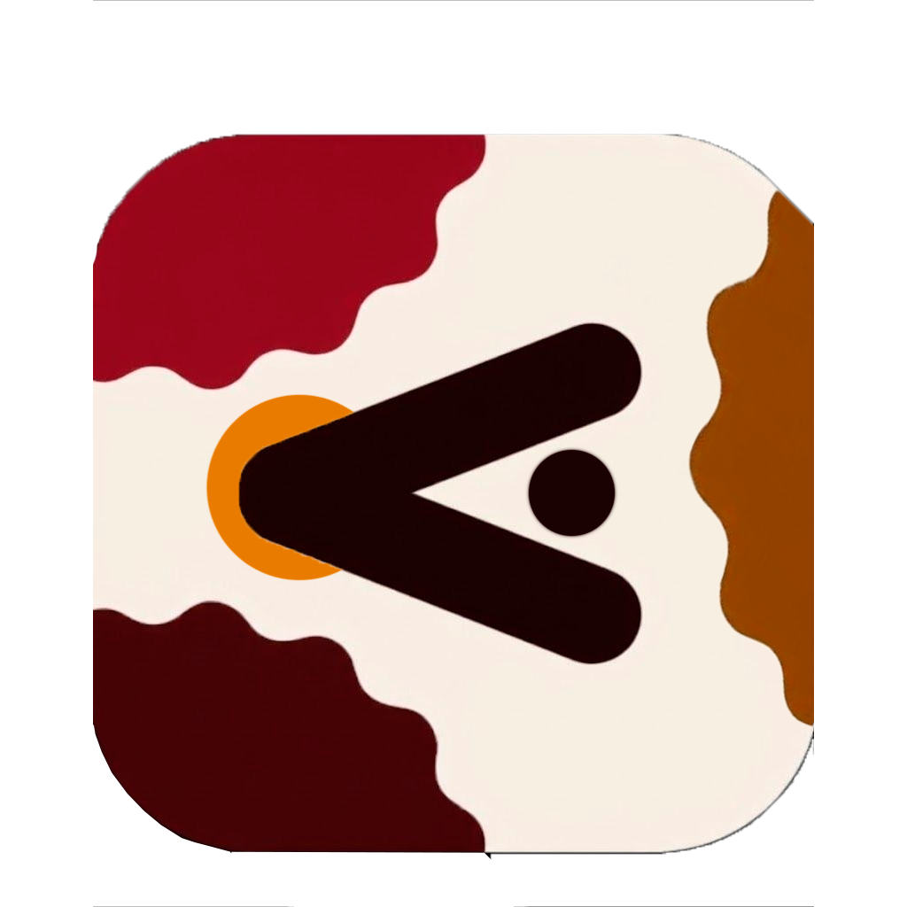
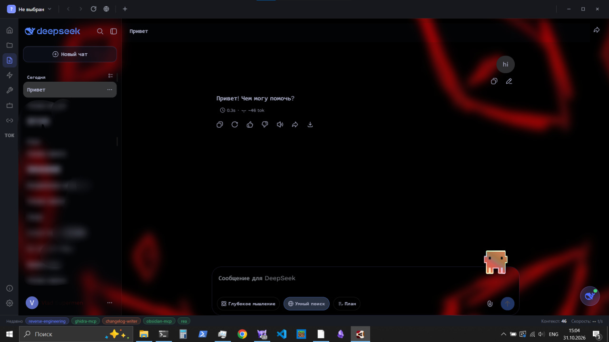
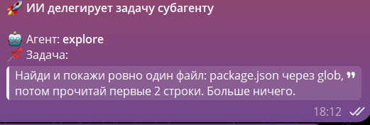
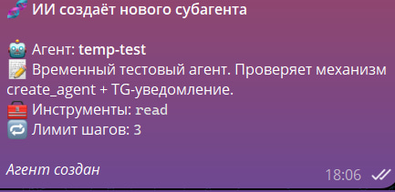

# Cookie Code 🍪

<p align="center">
  
</p>

<p align="center">
  <a href="https://github.com/merfiDEV/Cookie-code/releases/latest"></a>
  <a href="https://github.com/merfiDEV/Cookie-code/blob/master/LICENSE"></a>
  <a href="https://github.com/merfiDEV/Cookie-code"></a>
  <a href="https://github.com/merfiDEV/Cookie-code"></a>
</p>

<p align="center">
  <a href="README.en.md">English</a> · <strong>Русский</strong> · <a href="README.ru.md">Русский (полная версия)</a>
</p>

<p align="center">
  
</p>

**Cookie Code** превращает веб-чат DeepSeek в рабочее место разработчика. AI открывает файлы вашего проекта, запускает команды, правит код и делает коммиты, а вы остаётесь в том же чате.

Приложение работает через ваш обычный веб-аккаунт DeepSeek. API-ключ не нужен, по токенам вы не платите.

---

## Зачем это нужно

Веб-чат DeepSeek хорошо думает, но не видит проект. Он не может открыть файл, запустить тест или сделать коммит, поэтому код приходится копировать туда и обратно.

Cookie Code добавляет к чату локальный исполнитель. AI пишет блок с вызовом инструмента, приложение перехватывает его, выполняет в песочнице Node и возвращает результат обратно в чат. Дальше цикл повторяется: думай, действуй, смотри результат.

Что вы получаете:

- Работу через веб-аккаунт DeepSeek без API-ключей и оплаты по токенам.
- Полный агентный цикл: чтение файлов, правки, shell-команды, SQL-запросы, MCP-инструменты.
- Субагентов в отдельных окнах со своим контекстом и списком разрешённых инструментов.
- Git внутри приложения: diff, история, коммит и push.
- Управление с телефона через Telegram.
- Интерфейс, который можно перестроить под себя: обои, стекло, шрифты, темы.

---

## Возможности

### AI-агент, который работает с вашим кодом

AI умеет:

- Читать файлы: структуру проекта, содержимое, поиск по шаблону.
- Писать и править код: создавать файлы, применять патчи, удалять устаревшее.
- Запускать команды: bash, PowerShell, SQL-запросы, любые shell-скрипты.
- Искать по проекту: файлы по glob, содержимое по регулярному выражению.
- Вести список задач: создавать, отмечать, удалять.
- Загружать данные: HTTP-запросы и вызовы API.
- Подключать MCP-серверы и вызывать их инструменты.
- Помнить вас и проект в двух уровнях памяти.
- Работать по правилам проекта из `.cookie/rules.md`.

Как это выглядит:

1. Вы пишете: «Покажи последние изменения в auth.js».
2. AI отвечает блоком ```cuckoo с вызовом grep.
3. Cookie Code выполняет вызов и стримит результат в чат.
4. AI читает вывод и продолжает работу.

### Двухуровневая память

AI помнит и вас, и проект:

- Глобальная память (`<userData>/memory.md`) хранит факты о вас и системе.
- Проектная память (`<projectDir>/.cookie/memory/ProjectMemory.md`) хранит соглашения, архитектурные решения и важные пути конкретного проекта.

Инструменты `memorySave`, `memoryRead` и `memoryClear` принимают параметр `scope` со значениями `project`, `global` или `all`. Файлы открываются и очищаются в настройках.

### Правила проекта

Файл `.cookie/rules.md` задаёт правила, которые AI обязан принять через `readrules()`. Пока правила не приняты, инструменты, меняющие файлы, заблокированы. Если файла нет, блокировки тоже нет. Субагенты работают без этого гейта.

### Субагенты

<p align="center">
  
  
</p>

AI делегирует задачи изолированным агентам. Каждый работает в своём окне и своём контексте, а в основной диалог возвращается только итоговое резюме. Черновики и промежуточные вызовы родительский чат не засоряют.

Как это работает:

1. Вы просите: «Делегируй explore: найди все вызовы apiFetch».
2. AI вызывает `run_agent("explore", "...", "...")`.
3. Открывается отдельное окно с тем же логином DeepSeek.
4. Субагент работает в изоляции: `glob → read → grep`.
5. Когда он заканчивает, окно закрывается, в чат приходит резюме.

Три способа завести агента:

- Вручную: положите `cookie/agents/<имя>.md` с frontmatter в проект.
- Через AI: скажите «Создай агента для ревью SQL-миграций», AI вызовет `create_agent` и сразу его использует.
- Взять готовый: `explore`, `code-reviewer`, `git-committer`, `changelog-writer` и `page-scripter` уже лежат в проекте.

Что ограничивает субагента:

- Белый список инструментов. Укажите `tools: read, grep`, и агент физически не сможет вызвать `bash` или `mysql`.
- Запрет рекурсии. Субагент не может запустить ещё одного субагента.
- Лимит шагов `maxTurns`, который обрубает зацикливание.
- Таймаут 10 минут, после которого зависшее окно закрывается.

Пример агента:

```markdown
---
name: code-reviewer
description: Проверка качества кода. Использовать после написания кода.
tools: read, grep, glob
maxTurns: 20
---

Ты опытный эксперт по ревью кода...
```

### Цели

Команда `/goal` превращает задачу в самодвижущийся цикл: AI шаг за шагом идёт к цели без вашего участия между шагами.

- `/goal <описание>` задаёт цель, `/goal` показывает статус, `/goal stop|pause|resume` управляет ей.
- Когда раунд ответа завершается, Cookie Code сам отправляет AI «продолжай».
- Цель считается выполненной, когда AI вызывает инструмент `goalDone()`.
- От зацикливания защищают лимит итераций (50) и остановка после трёх раундов без прогресса.
- Панель «Цель» слева показывает текст цели, номер итерации, таймер и кнопки «Пауза» и «Выход».
- У каждого чата своя цель.
- Задавать цель и управлять ей можно из Telegram командой `/goal`, уведомления о старте и завершении приходят туда же.

### Интерфейс

- Стеклянные панели с настраиваемым размытием и прозрачностью.
- 27 обоев в комплекте.
- Анимированные петы, которые реагируют на вашу работу.
- Тёмная и светлая темы, переключение автоматическое или ручное.
- Свой шрифт: положите файл в папку и выберите его в настройках.
- RGB-эффект для никнейма.

### Защита

- Подтверждение инструментов: рискованные команды выполняются только после вашего согласия.
- Опасные паттерны: регулярные выражения для команд, которые нельзя запускать никогда.
- Скрытые служебные сообщения: чат остаётся чистым, но AI видит полный контекст.
- Белый список на сессию: подтвердите инструмент один раз, и до перезагрузки он работает свободно.
- Правила проекта: AI принимает их через `readrules()` до начала работы.
- Режим плана: AI сначала пишет план в `plan.md`, а не меняет код. План можно утвердить или отклонить, к строкам плана можно оставлять комментарии.

### Промпты проекта

Промпты лежат в `.cookie/prompts/*.md`, кнопка «Промпты» открывает их в оверлее. Промпт можно создать, изменить, удалить и вставить в поле ввода одной кнопкой. Из Telegram работает команда `/prompts`.

### Telegram-бот

Управление с телефона:

- `/status` показывает текущий проект, активные процессы и число задач.
- `/diff` присылает незакоммиченные изменения с подсветкой синтаксиса.
- `/log` листает историю коммитов и показывает diff выбранного коммита.
- `/todos` управляет списком задач.
- `/prompts` открывает промпты проекта.
- `/screen` делает скриншот активного окна.
- `/stop` убивает сбежавшие процессы.

Входящие сообщения печатаются в чат. Голосовые распознаются локальным Whisper и уходят в AI. Фото и файлы прикрепляются к полю ввода.

### Git

Встроенный просмотрщик diff:

- Вкладка «Изменения» показывает незакоммиченные правки построчно.
- Вкладка «История» листает коммиты, клик открывает полный diff.
- Навигация прыгает между hunks и фильтрует добавленные и удалённые строки.
- Мини-карта даёт обзор изменений целиком.
- Внутристрочный diff подсвечивает различия посимвольно.
- Кнопка «Коммит» собирает unified diff всех изменённых файлов и отправляет в чат готовое сообщение с просьбой закоммитить. Дальше можно позвать агента `git-committer` или закоммитить самому.

### Горячие клавиши

| Клавиша | Действие                                     |
| ------- | -------------------------------------------- |
| **F1**  | Показать текущий CHANGELOG (окно What's New) |
| **F11** | Полноэкранный режим                          |
| **F12** | Инструменты разработчика (DevTools)          |

---

## Что нового

Свежие крупные изменения:

- **Новый shell в стиле VS Code.** Переписан интерфейс: activity bar слева, панель страниц (Главная, Рабочие области, Файлы, Промпты, Скиллы, Субагенты, MCP, Token, О программе) и статус-бар. Окно без системной рамки со своими кнопками, F11 разворачивает на весь экран.
- **Дерево файлов проекта.** Папки и подпапки раскрываются, глубина 6 уровней, до 500 элементов на папку. Кнопка **@** вставляет в чат `User mentioned file: <абсолютный путь>`, для папки `User mentioned folder: <абсолютный путь>`. Есть поиск по имени и пути, превью файла в Monaco и открытие в системе.
- **Субагенты в отдельных лёгких окнах.** Открывается сразу чат DeepSeek с промптом и своим контекстом, без лишних панелей.
- **Скорость и токены.** Скорость вывода считается по разнице серверного `accumulated_token_usage` и показывается в реальном времени. Контекст и скорость видны в статус-баре.
- **Блок «Обнаружена задача» и История.** На Главной вместо пустой заглушки текущая команда или задача, индикатор выполнения, кнопка **Kill** и сворачиваемая история выполненных команд.
- **Промпты проекта.** Хранятся в `.cookie/prompts/*.md`, создаются, редактируются и удаляются в интерфейсе, вставляются в поле ввода одной кнопкой.
- **Обновления.** Кнопка «Проверить обновления» честно сообщает результат: обновлений нет, доступна новая версия, обновление скачано, ошибка или недоступно в dev-режиме. Версия на странице «О программе» берётся из последней записи `CHANGELOG.md`.

### Статистика

- Тепловая карта активности в стиле GitHub.
- Использование токенов по дням и неделям.
- Любимые модели.
- Самая длинная серия дней с кодом.

---

## Быстрый старт

### Скачать готовую сборку

**Windows:** скачайте [CookieCode-Setup.exe](https://github.com/merfiDEV/Cookie-code/releases/latest), запустите установщик, откройте приложение.

**macOS:** скачайте [CookieCode.dmg](https://github.com/merfiDEV/Cookie-code/releases/latest), перетащите в Applications, откройте.

### Собрать из исходников

```bash
git clone https://github.com/merfiDEV/Cookie-code.git
cd Cookie-code
npm install
npm start
```

Нужен Node.js 16 или новее.

---

## Использование

### Первый запуск

1. Выберите каталог проекта.
2. Выберите тему: обои, стеклянные эффекты, пет.
3. При желании настройте Telegram-бота.

### Работа

Просто общайтесь с AI:

```
Вы: "Покажи изменения, которые я сделал сегодня"
AI: запускает git diff и показывает три изменённых файла

Вы: "Напиши тесты для функции логина"
AI: читает auth.js, создаёт тесты, запускает их и сообщает результат

Вы: "Закоммить это"
AI: делает git commit с сообщением "feat(auth): добавлены тесты логина"
```

Боковая панель открывает сессии, список задач, git diff и настройки.

---

## Встроенные инструменты

В приложении зарегистрировано 44 инструмента. Основные:

| Инструмент          | Описание                          |
| ------------------- | --------------------------------- |
| `read`              | Прочитать содержимое файла        |
| `write`             | Создать или перезаписать файл     |
| `edit`              | Применить точечную правку         |
| `glob`              | Найти файлы по шаблону            |
| `grep`              | Поиск по содержимому файлов       |
| `bash` / `pwsh`     | Запуск shell-команд               |
| `mysql`             | SQL-запросы                       |
| `webFetch`          | HTTP-запросы                      |
| `todoWrite`         | Списки задач                      |
| `mcpCall`           | Инструменты MCP-сервера           |
| `skillLoad`         | Загрузка пользовательского скилла |
| `run_agent`         | Делегировать задачу субагенту     |
| `memorySave`        | Записать факт в память            |
| `goalDone`          | Завершить цель `/goal`            |
| `readrules`         | Принять правила проекта           |
| `ask_user_question` | Задать уточняющий вопрос          |
| `exitPlanMode`      | Отдать план из `plan.md`          |
| `attachFile`        | Прикрепить файл к чату            |
| `cityTime`          | Текущее время и город             |

Полные TypeScript-декларации лежат в [`tools/cuckoo-tools.d.ts`](tools/cuckoo-tools.d.ts).

---

## Настройка

**Темы:** размытие фона, прозрачность панелей, цвет стекла.

**Петы:** бросьте PNG или GIF в `userData/pets/` и выберите из сетки.

**Шрифты:** бросьте `.ttf` или `.woff` в `userData/fonts/` и выберите из списка.

**Скиллы:** папка с `SKILL.md` и необязательным `tool.js` в `.cuckoo/skills/<имя>/` для проекта или в `<userData>/skills/<имя>/` для всех проектов. Глобальный скилл перекрывает проектный с тем же именем.

---

## Участие в разработке

1. Форкните репозиторий.
2. Создайте ветку: `git checkout -b feature/amazing`.
3. Внесите изменения.
4. Прогоните тесты: `npm test`.
5. Закоммитьте: `git commit -m 'feat: add feature'`.
6. Отправьте ветку и откройте pull request.

Где нужна помощь:

- Переводы.
- Документация.
- Отчёты об ошибках.
- Новые инструменты.

---

## Лицензия

MIT. Используйте, изменяйте и распространяйте свободно, включая коммерческие проекты.

---

## Благодарности

Собрано на [Electron](https://electronjs.org/), [DeepSeek](https://deepseek.com/) и [Telegraf](https://github.com/telegraf/telegraf).

Вдохновлено [Aider](https://github.com/paul-gauthier/aider), [Claude Desktop](https://claude.ai/download) и [Cursor](https://cursor.sh/).

---

## История звёзд

[](https://star-history.com/#merfiDEV/Cookie-code&Date)

Если Cookie Code экономит ваше время, поставьте звезду.

---

<p align="center">
  Сделано с 🍪 разработчиками для разработчиков
</p>
