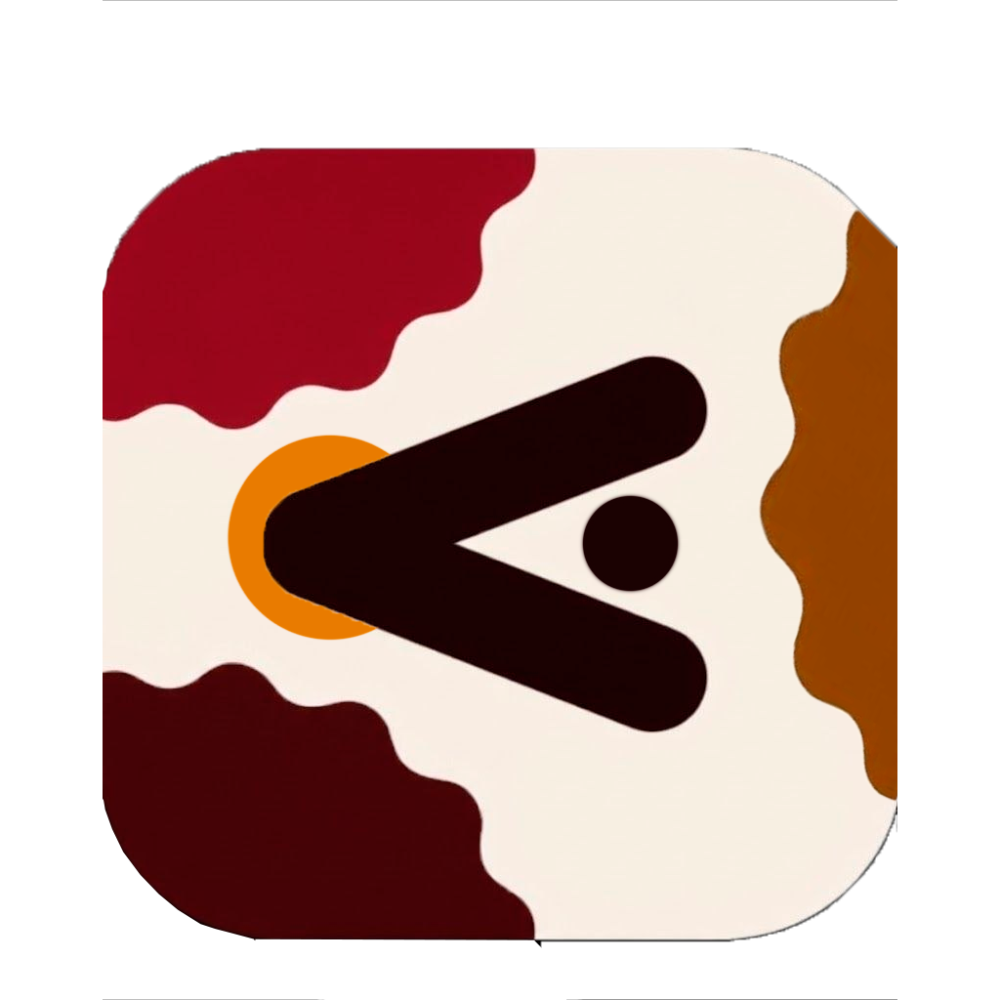
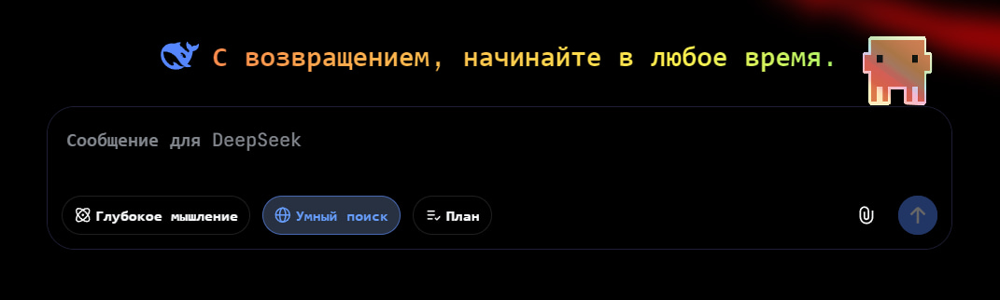
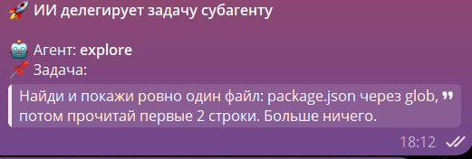
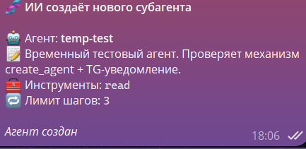
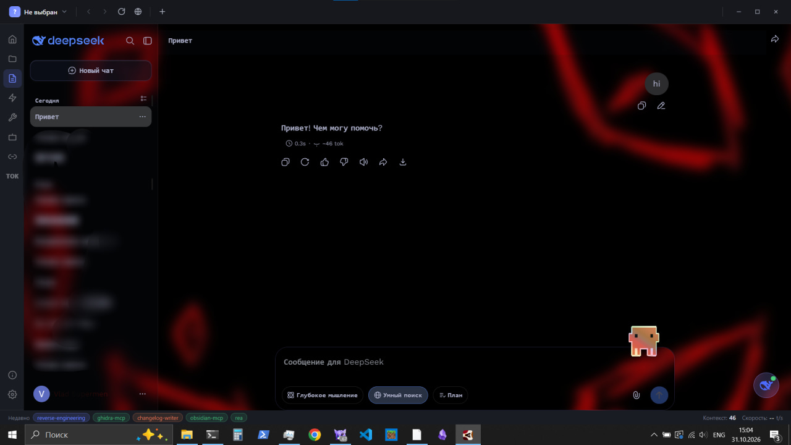
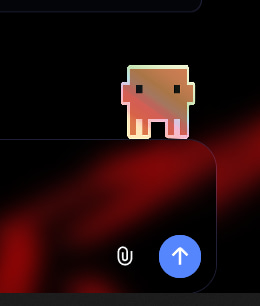

# Cookie Code 🍪

<p align="center">
  
</p>

<p align="center">
  <a href="https://github.com/merfiDEV/Cookie-code/releases/latest"></a>
  <a href="https://github.com/merfiDEV/Cookie-code/blob/master/LICENSE"></a>
  <a href="https://github.com/merfiDEV/Cookie-code"></a>
  <a href="https://github.com/merfiDEV/Cookie-code"></a>
  <a href="https://github.com/merfiDEV/Cookie-code"></a>
</p>

<p align="center">
  <a href="README.en.md">English</a> · <strong>Русский</strong>
</p>

**Cookie Code** превращает веб-чат DeepSeek в рабочее место разработчика. AI открывает файлы проекта, запускает команды, правит код и делает коммиты, а вы остаётесь в том же чате.

Приложение работает через ваш обычный веб-аккаунт DeepSeek. API-ключ не нужен, по токенам вы не платите.

---

## Зачем это нужно

Веб-чаты хорошо думают, но не действуют на вашей машине. DeepSeek не откроет файл, не запустит тест и не сделает коммит, поэтому код приходится копировать туда и обратно.

Cookie Code замыкает этот цикл. AI пишет блок с вызовом инструмента, приложение перехватывает его, выполняет в песочнице Node и возвращает результат в чат. Дальше цикл повторяется: думай, действуй, смотри результат.

Что вы получаете:

- Работу через веб-аккаунт DeepSeek без API-ключей и оплаты по токенам.
- Полный агентный цикл: файлы, поиск по коду, shell-команды, запросы к БД, MCP-инструменты.
- Нативную оболочку Electron с собственным оверлеем, темами и настройками.

---

## Возможности

### Выполнение инструментов

- AI отправляет вызовы инструментов блоками JavaScript с меткой `cuckoo`.
- Каждый вызов перехватывается, показывается в оверлее и выполняется в песочнице Node.
- Результаты автоматически стримятся в чат системным сообщением.
- Ненулевой код выхода shell (`[exit code: N]`) подсвечивается красным под соответствующим блоком.

### Инлайн tool-блоки

Каждый `cuckoo`-блок в чате превращается в раскрывающуюся карточку:

- Иконка ▼ и название инструмента: Read, Write, Edit, Bash, Glob, Grep, PowerShell, Todo, WebFetch, MCP, MySQL и другие.
- Подсказка с файлом из первого аргумента.
- Клик разворачивает и сворачивает карточку.
- При ошибке карточка получает красный стиль и иконку ⚠.

Стили переживают перезагрузку страницы: они восстанавливаются из `localStorage`.

### Мета ответа

Под каждым ответом AI появляется бейдж:

```
⏱ 5.2s · ~380 tok
```

- Реальное время ответа от начала стрима до завершения.
- Оценка токенов по формуле «символы / 4».
- Значение сохраняется в `localStorage` и восстанавливается после перезагрузки.

### Фоны

- 27 вручную отобранных обоев в комплекте.
- Выбор через сетку превью в **Настройки → Cookie Code**.
- Смена мгновенная, перезагрузка не нужна.

### Шрифт

Полный контроль над шрифтом интерфейса Cookie Code и страницы DeepSeek:

- Системный шрифт по умолчанию, ничего не навязывается.
- Встроенный Anthropic Mono выбирается одним кликом.
- Свои шрифты: положите файлы `.ttf`, `.otf`, `.woff` или `.woff2` в папку `<userData>/fonts`, нажмите кнопку «Открыть папку шрифтов», затем «Обновить». Шрифт появится в сетке превью.
- Слайдер жирности от 100 до 900 работает и для системного, и для своего шрифта.
- Настройки сохраняются в `cuckoo-settings.json` в полях `font` и `fontWeight`.

<p align="center">
  
</p>

### Блюр и прозрачность

Стеклянный эффект настраивается целиком:

- Блюр фонового изображения от 0 до 30 px.
- Блюр шапки и сайдбара.
- Прозрачность шапки, сайдбара и tool-блоков.
- Стекло tool-блоков.

Все значения лежат в `cuckoo-settings.json`.

### RGB-ник

Ник пользователя в сайдбаре получает анимированный радужный градиент и включён по умолчанию. Отключается в **Настройки → Cookie Code → Эффекты**.

### Telegram-бот

<p align="center">
  
  <br>
  
  
</p>

- Уведомления об инструментах: каждый вызов с успехом или ошибкой, именем, аргументами и результатом приходит в ваш чат. Для `edit` показывается новый код до 2000 символов.
- Ответы AI дублируются в Telegram как обычный текст без code-блоков.
- Входящие сообщения: напишите боту, и текст попадёт в чат DeepSeek, как если бы вы набрали его сами.
- `/todos` показывает список задач активного окна.
- `/prompts` открывает промпты проекта: список с кнопками «Вставить» и «Удалить», плюс создание с пошаговым вводом имени и текста.
- `/help` выводит полную справку по командам.
- `/settings` открывает интерактивное меню с inline-кнопками. С телефона правятся внешний вид (кастомизация, RGB-ник, язык), стекло и панель (размытие, прозрачность, ширина, цвета), агент и приватность (режим подтверждения, скрытие служебных сообщений, авто-форматтеры, файловые чипы, затронутые файлы, список опасных паттернов), а также сам бот (токен, chat ID, тумблеры уведомлений). Обои в меню намеренно не вынесены.
- `/cancel` отменяет ожидающий ввод.
- Клиент лёгкий и без зависимостей: long-polling, без VPS и webhook.
- Настройка идёт в **Настройки → Cookie Code → Telegram-бот** (токен от @BotFather и chat ID) или из самого Telegram через `/settings`.

### Чистое окно

Системного меню Electron нет, приложение сразу открывается в DeepSeek. Стандартные сочетания клавиш (Ctrl+C, Ctrl+V, Ctrl+R, F12) работают.

### Двухуровневая память

AI помнит и вас, и проект, причём память разделена на два независимых уровня:

| Уровень       | Где хранится                                   | Что помнит                                                               |
| ------------- | ---------------------------------------------- | ------------------------------------------------------------------------ |
| 🌍 Глобальная | `<userData>/memory.md`                         | Факты о пользователе и системе: имя, ОС, GPU, предпочтения по стилю кода |
| 🗂 Проектная   | `<projectDir>/.cookie/memory/ProjectMemory.md` | Соглашения, архитектурные решения, важные пути, стек конкретного проекта |

- Инструменты `memorySave(text, scope?)`, `memoryRead(scope?)` и `memoryClear(scope?)` принимают `scope` со значениями `project`, `global`, а `memoryRead` ещё и `all`.
- По умолчанию `memorySave` пишет в проектную память, если проект инициализирован, иначе в глобальную.
- Абсолютные пути к обоим файлам подставляются в системный промпт и доступны в JS-скриптах как `globalThis.memoryPath` и `globalThis.projectMemoryPath`.
- Файлы открываются, очищаются и показывают статистику отдельно для каждого уровня в **Настройки → Cookie Code**.
- Проектная память лежит в `.gitignore`, поэтому личные заметки AI не коммитятся.

### Горячие клавиши

| Клавиша | Действие                                     |
| ------- | -------------------------------------------- |
| **F1**  | Показать текущий CHANGELOG (окно What's New) |
| **F11** | Полноэкранный режим                          |
| **F12** | Инструменты разработчика (DevTools)          |

Окно What's New (F1) перетаскивается за шапку и подстраивает ширину под экран.

## Что нового

Свежие крупные изменения:

- **Shell в стиле VS Code.** Интерфейс переписан: activity bar, боковые страницы (Главная, Рабочие области, Файлы, Промпты, Скиллы, Субагенты, MCP, Token, О программе) и статус-бар. Окно без системной рамки со своими кнопками, F11 разворачивает на весь экран.
- **Дерево файлов проекта.** Папки и подпапки раскрываются, кнопка **@** вставляет в чат `User mentioned file: <абсолютный путь>` или `folder` для папки. Есть превью в Monaco и открытие в системе.
- **Субагенты в лёгких окнах.** Открывается только чат DeepSeek с промптом и изолированным контекстом, без shell-обвязки.
- **TPS и токены.** Скорость вывода считается по разнице серверного `accumulated_token_usage`, с запасной оценкой по длине текста. Контекст и скорость видны в статус-баре.
- **Блок «Обнаружена задача» и История.** На Главной текущая команда или задача, индикатор выполнения, кнопка **Kill** и сворачиваемая история выполненных команд.
- **Промпты проекта.** Лежат в `.cookie/prompts/*.md`, создаются, редактируются и удаляются, вставляются в поле ввода одним кликом, при желании с авто-отправкой.
- **Обновления.** «Проверить обновления» честно сообщает результат: актуально, доступна новая версия, скачано, ошибка или недоступно в dev-режиме. Версия на странице «О программе» берётся из последней записи `CHANGELOG.md`.
- **Прочее.** Клик по агенту или скиллу вставляет `Use the <name> agent` или `Use the <name> skill`; иконка приложения на странице «О программе» берётся из билда; heatmap статистики стал компактнее; агенты и скиллы ищутся в `cookie/agents`, `.cuckoo/agents` и `~/.cookie/agents`.

### Перенос контекста

Длинный чат можно продолжить в новом, не теряя наработок:

- Кнопка **«Перенести контекст»** в панели Cookie Code.
- История текущего чата читается из DOM, AI сжимает её в структурный конспект: цель, решения, изменённые файлы, открытые вопросы.
- Новый чат открывается автоматически, конспект вставляется как контекст, работа продолжается с того же места.
- Длинные истории автоматически подрезаются по оценке токенов.

### Инициализация проекта

Выберите каталог проекта один раз. AI получит дерево каталога и системный промпт, собранный под реальный проект. Дальше все вызовы инструментов разрешают пути относительно этого каталога.

### Поддержка MCP

Формат конфигурации совместим с Claude Desktop. Поддерживаются MCP-серверы типов `stdio` и `http`. Серверы и инструменты управляются из оверлея.

### Скиллы

Положите папку в `.cuckoo/skills/<name>/` с файлом `SKILL.md` и необязательным `tool.js`, и она станет вызываемой через `skillList`, `skillLoad` и `skillExecute`.

Скиллы бывают двух уровней: глобальные в `<userData>/skills/<name>/` и проектные в `<projectDir>/.cuckoo/skills/<name>/`. При совпадении имён глобальный перекрывает проектный.

### Промпты проекта

Часто используемые промпты вставляются в чат одной кнопкой. Они лежат в `.cookie/prompts/*.md`, один файл на промпт. Кнопка **«Промпты»** в оверлее открывает панель: создать, изменить, удалить промпт и вставить его текст в поле ввода. Из Telegram работает команда `/prompts`.

### Субагенты

<p align="center">
  
  
</p>

Cookie Code делегирует задачи изолированным AI-агентам. Каждый субагент работает в отдельном окне с тем же partition и общим логином DeepSeek, в своём контексте, и возвращает родителю только финальное резюме. Черновики, поиски и tool-вызовы основной диалог не засоряют.

Пример:

1. Вы просите: «Делегируй explore: найди все вызовы apiFetch».
2. AI вызывает `run_agent("explore", "найди все вызовы apiFetch")`.
3. Открывается второе окно, туда автоматически уходит системный промпт и задача.
4. Субагент работает: `glob → read → grep`.
5. Когда он пишет финал без `cuckoo`-блоков, окно закрывается, а в родительский чат приходит только резюме.

Три способа завести агента:

- Вручную: положите `cookie/agents/<name>.md` с frontmatter в проект.
- Через AI: попросите «Создай агента для ревью SQL-миграций», AI вызовет `create_agent` и сможет сразу его использовать.
- Взять готовый: в проекте уже есть `explore`, `code-reviewer`, `git-committer`, `changelog-writer` и `page-scripter`.

Формат файла агента (`<проект>/cookie/agents/<имя>.md`):

```markdown
---
name: code-reviewer
description: Проверка качества кода. Использовать после написания кода.
tools: read, grep, glob
maxTurns: 20
---

Ты опытный эксперт по ревью кода. Проверь указанный код, найди
реальные проблемы и дай рекомендации.
```

Поля frontmatter:

| Поле          | Обязательно | Описание                                                  |
| ------------- | ----------- | --------------------------------------------------------- |
| `name`        | нет         | Имя агента, по умолчанию имя файла без `.md`              |
| `description` | **да**      | Когда делегировать. Без него агент игнорируется           |
| `tools`       | нет         | Разрешённые инструменты через запятую. Пусто означает все |
| `maxTurns`    | нет         | Лимит шагов от 1 до 1000, защита от зацикливания          |

Изоляция и защита:

- 🔒 **Белый список инструментов.** С `tools: read, grep` агент физически не сможет вызвать `bash`, `mysql` или `deleteFile`: блокировка стоит на двух уровнях, в JsRunner и в main IPC.
- 🚫 **Запрет рекурсии.** Субагент не может вызвать `run_agent`.
- ⏱ **maxTurns** обрубает бесконечные циклы.
- ⏲ **Таймаут 10 минут** принудительно закрывает зависшее окно.
- 📁 **Общий projectDir.** Субагент видит ту же рабочую папку, что и родитель.
- 🎯 **Прогрессивное раскрытие.** В системный промпт родителя идут только `name` и `description`, полный `systemPrompt` читается при запуске.

Уведомления в Telegram:

1. Карточка запуска: `🚀 ИИ делегирует задачу субагенту`, имя и задача.
2. Каждый tool-вызов агента: `🤖 Агент: explore` и `📖 Reading file.js`.
3. Финальный результат: `🎯 Субагент вернул результат` и резюме.

### Цели (goal-режим)

Команда `/goal` превращает одну задачу в автономный многораундовый цикл: AI продвигается шаг за шагом, пока не выполнит цель, без вашего участия между шагами.

Как это работает:

1. Введите в чате `/goal <описание цели>` или задайте цель из Telegram.
2. AI получает инструкцию цели и начинает работу.
3. Когда раунд ответа завершается без tool-вызовов, Cookie Code автоматически отправляет AI «продолжай».
4. Когда цель выполнена, AI вызывает `goalDone()` и цикл останавливается.

Управление:

| Команда                        | Действие                     |
| ------------------------------ | ---------------------------- |
| `/goal <текст>`                | Задать цель                  |
| `/goal`                        | Показать статус текущей цели |
| `/goal stop`                   | Остановить цель              |
| `/goal pause` / `/goal resume` | Пауза и возобновление        |

Панель «Цель» слева показывает текст цели, номер итерации, время работы и кнопки **Пауза** и **Выход**. Панель можно перетаскивать.

Защита от зацикливания:

- ⏱ Лимит итераций: по умолчанию 50 раундов, настройка `cuckoo-goal-max-iterations`.
- 🔁 Нет прогресса: если три раунда подряд дают одинаковый вывод, цель останавливается.
- ⏸ Ручная остановка: `/goal stop` или кнопка «Выход» прерывают цикл мгновенно.

У каждого чата своя цель, при переключении сессии состояние сохраняется отдельно. При старте и завершении цели в Telegram приходят уведомления, задавать цель и управлять ею можно из бота.

### Авто-форматтеры

Каждый `write` и `edit` прогоняет файл через форматтер для его языка, поэтому код AI сразу приводится к стилю проекта. Запускать `prettier --write` вручную не нужно, и стиль не мешает в diff.

| Форматтер      | Для чего                                                      | Что нужно                                                                       |
| -------------- | ------------------------------------------------------------- | ------------------------------------------------------------------------------- |
| `prettier`     | `.js`, `.jsx`, `.ts`, `.tsx`, `.json`, `.css`, `.md`, `.yaml` | `prettier` в ближайшем `package.json` и бинарь в `node_modules/.bin` или `PATH` |
| `biome`        | то же, что prettier                                           | `biome.json` или `biome.jsonc` в проекте                                        |
| `gofmt`        | `.go`                                                         | `gofmt` в `PATH`                                                                |
| `ruff`         | `.py`, `.pyi`                                                 | `ruff` в `PATH` и `[tool.ruff]` в `pyproject.toml` или `ruff.toml`              |
| `rustfmt`      | `.rs`                                                         | `rustfmt` в `PATH`                                                              |
| `shfmt`        | `.sh`, `.bash`                                                | `shfmt` в `PATH`                                                                |
| `clang-format` | `.c`, `.cpp`, `.h`                                            | конфиг `.clang-format` и `clang-format` в `PATH`                                |

- Определение учитывает конфиг проекта: ruff не запустится без `[tool.ruff]`, prettier без зависимости в `package.json`. Чужой код сам по себе не форматируется.
- Ошибки форматтера глушатся, падение форматтера никогда не блокирует `write` и `edit`.
- Отключается через `"formattersEnabled": false` в `cuckoo-settings.json`.

### Персистентность сессии

Логин, проекты и настройки хранятся в `%APPDATA%/cuckoo-ai-pro-session` на Windows и в аналогичном пути userData на macOS и Linux.

---

## Установка

### Требования

- Node.js 16.0.0 или новее
- npm

### Из исходников

```bash
git clone https://github.com/merfiDEV/Cookie-code.git
cd Cookie-code

npm install

# Если npm блокирует postinstall electron (allowScripts), одобрите его:
#   npm install-scripts ls
#   npm install-scripts approve electron
#   npm install

npm start
```

### Сборка

```bash
# Установщик Windows (NSIS)
npm run build:win

# Portable
npm run build:win:portable

# macOS DMG
npm run build:mac:dmg
```

---

## Использование

1. Запустите приложение, оно сразу откроется в DeepSeek.
2. Войдите в свой аккаунт DeepSeek.
3. Нажмите **«Инициализировать проект»** и выберите каталог. Теперь AI видит дерево проекта и системный промпт.
4. Общайтесь с AI: просите отредактировать файлы, выполнить команды, найти что-то в коде.
5. Вызовы инструментов в ответе AI перехватываются, показываются в оверлее и выполняются.
6. Результаты автоматически уходят обратно AI, и цикл продолжается.

### Пример вызова инструмента

AI генерирует блок вида:

```cuckoo
const content = await read("src/index.js");
log(content);
```

Cookie Code перехватывает его, выполняет в песочнице и возвращает результат AI.

---

## Доступные инструменты

В приложении зарегистрировано 44 инструмента.

| Инструмент                                 | Описание                                                                   |
| ------------------------------------------ | -------------------------------------------------------------------------- |
| `read`, `readLines`                        | Чтение файлов с номерами строк, offset и limit                             |
| `write`, `edit`                            | Создание и изменение файлов, с авто-форматированием при сохранении         |
| `deleteFile`                               | Удаление файла                                                             |
| `glob`, `grep`                             | Поиск по файлам на базе ripgrep                                            |
| `bash`, `pwsh`                             | Выполнение команд                                                          |
| `todoWrite`                                | Структурированный список задач                                             |
| `goalDone`                                 | Завершить цель `/goal` и остановить авто-продвижение                       |
| `webFetch`                                 | Загрузка HTTP(S) как Markdown                                              |
| `mysql`                                    | SQL-запросы                                                                |
| `mcpCall`, `mcpListServers`, `mcpGetTools` | MCP-инструменты                                                            |
| `skillList`, `skillLoad`, `skillExecute`   | Пользовательские скиллы                                                    |
| `readrules`                                | Прочитать и принять правила проекта, что разблокирует инструменты в сессии |
| `run_agent`                                | Делегировать задачу субагенту в отдельное окно с изолированным контекстом  |
| `create_agent`                             | Создать субагента в файле `cookie/agents/<имя>.md`                         |
| `list_agents`                              | Список доступных субагентов из проекта и пользовательских                  |
| `read_agent`                               | Полный systemPrompt субагента по имени                                     |
| `openBrowserWindow`, `injectJS`            | Окно браузера Electron и инъекция JS                                       |
| `injectPageJS`                             | Выполнить JS на странице                                                   |
| `ask_user_question`                        | Задать уточняющий вопрос с вариантами ответа                               |
| `exitPlanMode`                             | Отдать план из `plan.md` на утверждение                                    |
| `generateCommitMessage`                    | Собрать статус и diff для сообщения коммита                                |
| `attachFile`, `attachTelegram`             | Прикрепить файл в чат или отправить его в Telegram                         |
| `readPhoto`                                | Показать локальное изображение модели                                      |
| `cityTime`                                 | Текущее время и город пользователя                                         |

Полные TypeScript-декларации лежат в `tools/cuckoo-tools.d.ts`.

---

## Кастомизация

Cookie Code рассчитан на перестройку: меняйте обои, настраивайте стекло, задавайте акцентный цвет, пишите свои скиллы и расширяйте набор инструментов.

<p align="center">
  
  <br>
  
  <br>
  
  <br>
  
</p>

### Внешний вид

Всё визуальное живёт в **Настройки → Cookie Code** и сохраняется в `cuckoo-settings.json`:

- **Фоны** — 27 встроенных обоев, либо положите своё изображение в `src/ui/backgrounds/` и зарегистрируйте его в `registry.json`.
- **Стеклянный эффект** — размытие фона / шапки / сайдбара, прозрачность и размытие стекла tool-блоков.
- **Шрифт** — системный по умолчанию, встроенный Anthropic Mono или свои шрифты из папки; слайдер жирности (100–900). Применяется и к интерфейсу, и к странице DeepSeek.
- **RGB-никнейм** — анимированный радужный градиент в сайдбаре, переключается в разделе **Effects**.
- **Питомцы (чубрики)** — посадите спрайт прямо на поле ввода: он сидит на верхней границе, ездит вместе с полем, перетаскивается мышкой и масштабируется за уголок. Место посадки хранится в долях поля, поэтому пет остаётся на своём месте при любом разрешении и зуме.

<p align="center">
  
</p>

- **Свои спрайты** — положите PNG/GIF в `<userData>/pets/` — все файлы сразу появятся в сетке выбора в настройках («Загрузить…» тоже работает: любые картинки автоматически сжимаются до 600×600).
- **Вырезание фона у GIF** — если у гифки белый (или любой другой) фон, откройте редактор (кнопка «🎨 Фон» на превью) и тыкните пипеткой в ненужный цвет. Фон исчезнет во всех кадрах, анимация сохранится.
- **Debug-режим (F8–F11)** — тонкая настройка посадки: **F8** — прицел (кликнуть в точку), **F9** — debug-рамка поля, **F10** — режим «приклеен / свободный», **F11** — сброс размера. Включается тумблером в настройках.

### Пользовательские скиллы

Свой вызываемый скилл добавляется без правки кода приложения:

```
.cuckoo/skills/<skill-name>/
├── SKILL.md    # инструкции для AI
└── tool.js     # необязательные экспортируемые функции
```

AI получает к нему доступ через `skillList`, `skillLoad` и `skillExecute`.

### Правила проекта

Проект задаёт правила, которые AI обязан принять до начала работы:

```
.cookie/rules.md
```

Пока правила не приняты, инструменты кроме `read`, `read_lines`, `file_read`, `memoryRead` и `readrules` заблокированы. В начале системного промпта AI видит напоминание прочитать память и правила и вызвать `readrules()`. После вызова блокировка для сессии снимается.

- Если файла `.cookie/rules.md` нет, упоминания правил в промпте нет, и инструменты работают свободно.
- Субагенты не блокируются, они работают без гейта правил.

### Режим плана и комментарии

Кнопка **«План»** рядом с тумблерами DeepSeek включает режим планирования. AI только исследует проект и пишет план в `plan.md`, не меняя код. Готовый план он отдаёт на утверждение через `exit_plan_mode()`, а вы соглашаетесь или отклоняете.

- **Комментарии к строкам.** Выделите фрагмент плана, появится кнопка «💬», оставьте замечание прямо под нужной строкой. Комментировать можно несколько строк.
- **При отклонении** замечания возвращаются модели как результат `exit_plan_mode`: текст, строка и выделение.
- **При согласии** комментарии прикладываются к запросу «Работай в соответствии с планом» и уходят в чат.
- План можно утвердить и из Telegram.

### Пользовательские инструменты

Реализации инструментов лежат в `tools/` и работают в главном процессе. Добавьте функцию, объявите её в `tools/cuckoo-tools.d.ts`, и AI сможет вызывать её как любой встроенный инструмент.

### Провайдер

Адаптер DeepSeek находится в `src/providers/deepseek.js`. Форкните его, чтобы подключить Cookie Code к другой платформе веб-чата.

---

## Безопасность

- Гейт подтверждения tool-вызовов с режимами off, risky и all. Настраивается в приложении или через Telegram `/settings`.
- Таймаут команды 30 секунд, таймаут песочницы 60 секунд.
- Буфер вывода 1 МБ.
- Редактируемый чёрный список опасных команд (`rm -rf /`, `format`, `diskpart` и другие) из регулярных выражений. Меняется в настройках или через Telegram.
- Авто-форматтеры запускаются только когда этого требует конфиг проекта и никогда не блокируют `write` и `edit`.
- Пути файлов ограничены каталогом проекта.

---

## Конфигурация

Настройки хранятся в `cuckoo-settings.json` в userData-каталоге приложения:

```json
{
  "background": "miku",
  "backgroundBlur": 0,
  "font": "system",
  "fontWeight": 400,
  "headerBlur": 12,
  "sidebarBlur": 12,
  "headerOpacity": 45,
  "sidebarOpacity": 45,
  "toolBlockOpacity": 55,
  "toolBlockBlur": 0,
  "rgbUsername": true,
  "formattersEnabled": true,
  "fileChipEnabled": true,
  "showProducedFiles": true,
  "language": "ru",
  "telegramEnabled": false,
  "telegramBotToken": "",
  "telegramChatId": "",
  "telegramNotifyTools": false,
  "telegramChatFeed": false
}
```

Все настройки редактируются в **Настройки → Cookie Code**.

---

## Структура проекта

```
src/
├── main/            Главный процесс Electron
│   ├── index.js         Точка входа, создание окон
│   ├── ipc.js           IPC-обработчики
│   ├── shell-ipc.js     IPC для shell-интерфейса
│   ├── git-gitops.js    Git-операции
│   ├── settings-store   Пользовательские настройки
│   ├── profile-manager  Профили окон
│   ├── session-store    Сессия и каталог проекта
│   ├── mcp-client       Интеграция MCP SDK
│   ├── skill-manager    Загрузка скиллов
│   ├── format-registry  Встроенные форматтеры
│   ├── formatter        Авто-формат после write и edit
│   └── window.js        Реестр окон
├── preload/
│   ├── api.js           contextBridge → electronAPI
│   ├── index.js         Инициализация
│   ├── i18n/i18n.js     Переводы RU и EN, хелпер t(key, params)
│   ├── dom/             Парсеры DOM и observers
│   └── overlay/         Оверлей-панель
├── providers/
│   └── deepseek.js      Адаптер платформы
├── ui/
│   ├── shell/           Интерфейс в стиле VS Code (HTML, CSS, React)
│   ├── backgrounds/     27 обоев и registry.json
│   ├── fonts/           Встроенные шрифты
│   └── vendor/monaco    Вендоренный Monaco Editor
tools/                 Реализация инструментов в главном процессе
├── cuckoo-tools.d.ts  TypeScript-декларации для AI
botsrc/                Telegram-бот без зависимостей
├── telegram.js          Клиент Telegram (long-polling)
└── index.js             Настройки, уведомления, приём сообщений
```

---

## Лицензия

[MIT](LICENSE)
